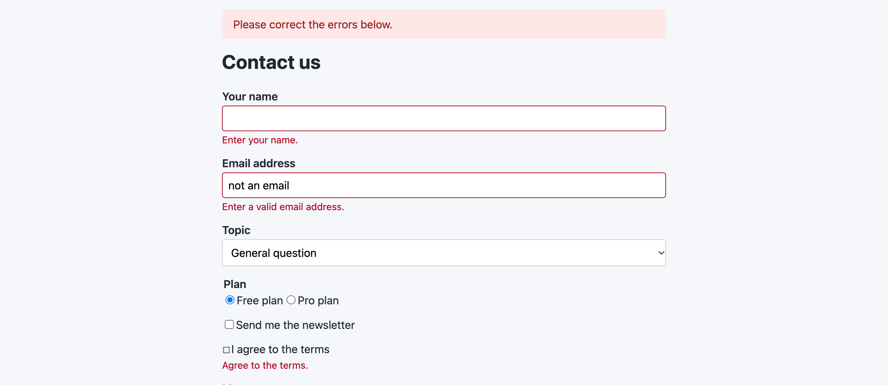

# テストを書く

<a id="a-test-case"></a>

## テストケース

テストは `tests/TestCase/EndToEnd/` (レガシー構成では `app/Test/Case/EndToEnd/`) に置き、
`PantherTestCase` を継承します ([docs/examples/ArticlesTest.php](../examples/ArticlesTest.php))。

```php
<?php
declare(strict_types=1);

namespace App\Test\TestCase\EndToEnd;

use ClassRegistry;
use PieceOfCake2\Panther\TestSuite\PantherTestCase;

class ArticlesTest extends PantherTestCase
{
    /**
     * @var array<string>
     */
    public $fixtures = ['app.article'];

    /**
     * @return void
     */
    public function testIndexShowsTheFixtureRecords(): void
    {
        $client = static::createPantherClient();
        $client->request('GET', '/articles');

        $this->assertPageTitleContains('Articles');
        $this->assertSelectorTextContains('table', 'First article');
    }

    /**
     * @return void
     */
    public function testAdd(): void
    {
        $client = static::createPantherClient();
        $crawler = $client->request('GET', '/articles/add');

        // FormHelper puts a hidden input before each checkbox: click the checkbox itself
        $crawler->filter('#ArticlePublished')->click();
        $client->submitForm('Submit', [
            'data[Article][title]' => 'Written in the browser',
            'data[Article][body]' => 'Hello',
        ]);

        $this->assertSelectorTextContains('.message', 'The article has been saved.');
        $this->assertSame(1, ClassRegistry::init('Article')->find('count', [
            'conditions' => ['Article.title' => 'Written in the browser', 'Article.published' => true],
        ]));
    }
}
```

`static::createPantherClient()` はブラウザーを返します。実行中の最初の呼び出しで Web サーバーと Chrome が
起動し、それ以降の呼び出しでは同じブラウザーが返されます。

<a id="opening-pages"></a>

## ページを開く

```php
$client = static::createPantherClient();
$crawler = $client->request('GET', '/articles?page=2');   // a path of the application
$crawler = $client->clickLink('Next');
$client->back();

$client->getCurrentURL();                                   // http://127.0.0.1:9080/articles?page=2
$crawler->filter('h1')->text();                             // the visible text
$client->executeScript('return document.title;');
$client->takeScreenshot('tmp/articles.png');
```

クライアントは BrowserKit のクライアントで、クローラーは要素が WebDriver の要素である DomCrawler の
クローラーです。[Panther のドキュメント](https://symfony.com/doc/current/testing/end_to_end.html#usage)
をご覧ください。

<a id="forms"></a>

## フォーム

`submitForm()` は、ボタンを含むフォームのフィールドを `name` で指定して入力し、フォームを送信します。

```php
$client->submitForm('Log in', [
    'data[User][email]' => 'user@example.com',
    'data[User][password]' => 'secret',
]);
```

`data[User][email]` のように、CakePHP の完全な名前を指定してください。ネストした配列はサポートされて
いません。`FormHelper` のチェックボックスは、その前に同じ名前の hidden の input を出力するので、送信する
前にチェックボックスをクリックしてください: `$crawler->filter('#UserRememberMe')->click()`。
フォームはブラウザーが送信するので、`SecurityComponent` のトークンも機能します。

<a id="waiting-for-javascript"></a>

## JavaScript を待つ

```php
$crawler->filter('#load-more')->click();
$client->waitFor('.comment');                          // in the DOM
$client->waitForVisibility('#dialog');
$client->waitForElementToContain('#total', '3 items');

// or as assertions
$this->assertSelectorWillContain('#total', '3 items');
$this->assertSelectorWillNotBeVisible('.spinner');
```

<a id="cookies-and-logging-in"></a>

## Cookie とログイン

Panther と同じように、ブラウザーは Cookie とともにテストからテストへ引き継がれます。ログアウトした状態で
始める必要があるテストでは、まず Cookie をクリアします。

```php
$client = static::createPantherClient();
$client->request('GET', '/');
$client->getCookieJar()->clear();
```

ベースクラスのヘルパーメソッドでログインフォームからログインするか、後続のテストのために意図的に
ログインしたままにしておいてください。

<a id="several-browsers"></a>

## 複数のブラウザー

`static::createAdditionalPantherClient()` は、別の独立したブラウザーを開きます。たとえば、チャットの
2 人目のユーザーに使います。アサーションは最後に作成されたブラウザーを確認します。

<a id="mobile-viewport"></a>

## モバイルのビューポート

Panther にはデバイスのプリセットがなく、ヘッドレスの Chrome は `--window-size` で
ウィンドウを 500 ピクセルより狭くしません。php-webdriver の DevTools プロトコルでスマートフォンをエミュレートし、
ブラウザーは次のテストに引き継がれるので、最後にリセットしてください。

```php
use Facebook\WebDriver\Chrome\ChromeDevToolsDriver;

$client = static::createPantherClient();
$devTools = new ChromeDevToolsDriver($client->getWebDriver());
$devTools->execute('Emulation.setDeviceMetricsOverride', ['width' => 390, 'height' => 844, 'deviceScaleFactor' => 3, 'mobile' => true]);
try {
    $client->request('GET', '/');
    $this->assertSelectorIsVisible('.menu-toggle');
} finally {
    $devTools->execute('Emulation.clearDeviceMetricsOverride');
}
```

`Emulation.setUserAgentOverride` と `Emulation.setTouchEmulationEnabled` も、同じ方法で User-Agent と
タッチイベントを変更します。

<a id="assertions"></a>

## アサーション

`PantherTestCase` には、Symfony と Panther の `WebTestAssertionsTrait` のアサーションがあります。
これらは最後に作成されたブラウザーのページを確認します。ロケーターは CSS セレクター、または `/` で
始まる XPath 式です。

| アサーション | 確認する内容 |
| --- | --- |
| `assertSelectorExists($selector)`、`assertSelectorNotExists($selector)` | 一致する要素があること |
| `assertSelectorCount($count, $selector)` | 一致する要素の数 |
| `assertSelectorTextContains($selector, $text)`、`assertSelectorTextNotContains()`、`assertSelectorTextSame()` | 最初に一致した要素の表示されているテキスト |
| `assertPageTitleSame($title)`、`assertPageTitleContains($title)` | `<title>` |
| `assertInputValueSame($name, $value)`、`assertInputValueNotSame()` | フィールドの現在の値。名前で指定します。例: `data[Article][title]` |
| `assertCheckboxChecked($name)`、`assertCheckboxNotChecked($name)` | チェックボックス。名前で指定します |
| `assertBrowserHasCookie($name)`、`assertBrowserNotHasCookie($name)`、`assertBrowserCookieValueSame($name, $value)` | ブラウザーの Cookie |
| `assertSelectorIsVisible($locator)`、`assertSelectorIsNotVisible()` | 最初に一致した要素が表示されているかどうか |
| `assertSelectorIsEnabled($locator)`、`assertSelectorIsDisabled()` | 有効かどうか |
| `assertSelectorAttributeContains($locator, $attribute, $text)`、`assertSelectorAttributeNotContains()` | 属性。`$text = null` は属性が設定されていないことを確認します |
| `assertSelectorWillExist()`、`assertSelectorWillNotExist()`、`assertSelectorWillBeVisible()`、`assertSelectorWillNotBeVisible()`、`assertSelectorWillContain()`、`assertSelectorWillNotContain()`、`assertSelectorWillBeEnabled()`、`assertSelectorWillBeDisabled()`、`assertSelectorAttributeWillContain()`、`assertSelectorAttributeWillNotContain()` | 上と同じ内容を、そうなるまで待ってから確認します (Panther の `waitFor*()`) |

Symfony のレスポンスのアサーション (`assertResponseIsSuccessful()` など) はありません。WebDriver は
ステータスコードを公開しないためです。これらには `IntegrationTestTrait` を使ってください。

<a id="error-screenshots-and-the-interactive-mode"></a>

## エラー時のスクリーンショットとインタラクティブモード

`PANTHER_ERROR_SCREENSHOT_DIR` を設定して拡張を使うと、ブラウザーを作成した後に失敗またはエラーになった
テストは、ブラウザーごとにスクリーンショットを保存します。ファイル名は日付、失敗の種類、テストから
付けられます。



`PANTHER_NO_HEADLESS=1` と PHPUnit の `--debug` を使うと、失敗した後に Enter キーを押すまで実行が
一時停止するので、ブラウザーの状態を確認できます。

```bash
PANTHER_NO_HEADLESS=1 vendor/bin/phpunit --testsuite EndToEnd --debug
```

<a id="api-reference"></a>

## API リファレンス

<a id="panthertestcase"></a>

### PantherTestCase

`PieceOfCake2\Panther\TestSuite\PantherTestCase` は `CakeTestCase` を継承し、Panther の
`PantherTestCaseTrait` と、このパッケージの `WebTestAssertionsTrait` を使います。

| メンバー | 説明 |
| --- | --- |
| `static createPantherClient(array $options = [], array $kernelOptions = [], array $managerOptions = [])` | ブラウザー。最初の呼び出しで Web サーバーとブラウザーを起動します (Panther) |
| `static createAdditionalPantherClient()` | 別の独立したブラウザー (Panther) |
| `static createHttpBrowserClient(array $options = [])` | HTTP を通して動く、JavaScript なしのクライアント (Panther) |
| `static startWebServer(array $options = [])` | CakePHP 向けのデフォルトで Web サーバーを起動します。その後は Panther と同じ動作です |
| `static stopWebServer()`、`static isWebServerStarted()` | Panther |
| `static defaultWebServerDir(?string $projectRoot = null)` | プロジェクトの `webroot/` または `app/webroot/` (protected) |
| `tearDown()` | `CakeTestCase::tearDown()` の後、失敗したテストのスクリーンショットを保存します |
| `ROUTER` | CakePHP のルータースクリプトのパス |
| `CHROME`、`FIREFOX`、`SELENIUM` | `browser` オプションの値 |

<a id="webtestassertionstrait"></a>

### WebTestAssertionsTrait

`PieceOfCake2\Panther\TestSuite\WebTestAssertionsTrait`: [アサーション](#assertions) を提供します。
`PantherTestCaseTrait` を使うクラスで使ってください。

<a id="serverextension"></a>

### ServerExtension

`PieceOfCake2\Panther\ServerExtension` は、Panther の `ServerExtension` と同じことを行います。最後の
テストまで Web サーバーとブラウザーを動かしておき、失敗したテストのスクリーンショットを撮り、
インタラクティブモードでは一時停止します。また、最後のテストの後に `PantherTestCase` の Web サーバーと
ブラウザーを停止します。Panther の拡張の代わりにこれを登録してください。
